I design systems where a wrong number costs real money. Banking payments at a UK fintech and the platform that takes old phones back in 16,000 stores. Now Adlega, an AI CFO built on one rule: the model never does the math.

Building with AI every day showed me how often it sounds sure and is wrong. So I started measuring it. Every study below ships its raw data and scripts. Most also have a DOI. When the question was already answered by someone else, the repository says so and links to them.

### Studies

| | |
|---|---|
| **AI agents** | [tool-failure](https://github.com/dimhold/tool-failure) · [tool-honesty](https://github.com/dimhold/tool-honesty) · [tool-reach](https://github.com/dimhold/tool-reach) · [fault-labs](https://github.com/dimhold/fault-labs) · [fault-mcp](https://github.com/dimhold/fault-mcp) |
| **AI in finance** | [silent-books](https://github.com/dimhold/silent-books) · [boundary-split](https://github.com/dimhold/boundary-split) · [llm-arithmetic](https://github.com/dimhold/llm-arithmetic) · [stat-revision](https://github.com/dimhold/stat-revision) |
| **npm supply chain** | [npm-registry-census](https://github.com/dimhold/npm-registry-census) · [install-graph](https://github.com/dimhold/install-graph) · [dep-weight](https://github.com/dimhold/dep-weight) |
| **Postgres** | [key-order](https://github.com/dimhold/key-order) · [preview-cost](https://github.com/dimhold/preview-cost) |
| **Language** | [tokenizer-detect](https://github.com/dimhold/tokenizer-detect) · [tells-baseline](https://github.com/dimhold/tells-baseline) |

Papers written from them live at [dimhold.by/papers](https://dimhold.by/papers/).

### Built

- [Adlega](https://adlega.com): describe your business in a chat, get a working financial model. Every figure comes from a deterministic engine tested against the original Excel model.
- [whotop](https://github.com/dimhold/whotop): a terminal tool that tells look alike processes apart and names the port each one holds.
- [Belun](https://belun.app): 100+ free browser tools. No servers, no accounts, your files never leave the machine.
- [dimhold.by](https://dimhold.by): my workshop in English, Russian and Belarusian, where playable Belarusian folk games sit next to the essays.

[dimhold.by](https://dimhold.by) · [X @dimhold](https://x.com/dimhold) · [LinkedIn](https://www.linkedin.com/in/dimhold/) · [ORCID](https://orcid.org/0009-0009-3013-4978) · dimhold@gmail.com
